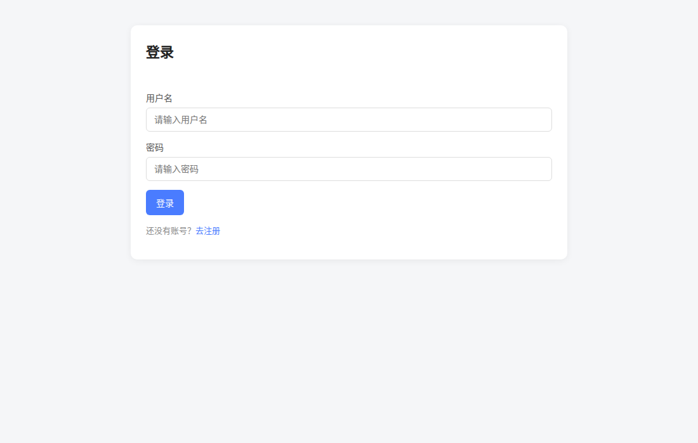
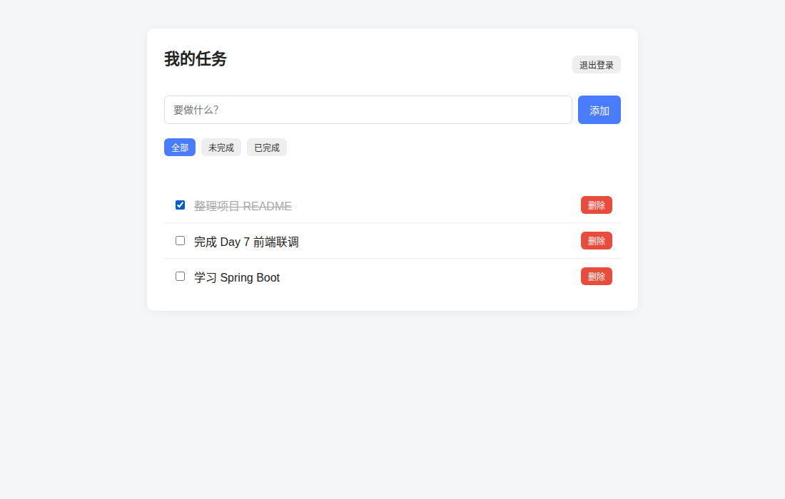

# 个人任务管理系统（PTMS）

Spring Boot + MyBatis + MySQL + 原生 HTML 的练手项目，实现注册、登录、JWT 鉴权和任务管理。

## 截图

| 登录 | 我的任务 |
|---|---|
|  |  |

## 功能

- 注册 / 登录，密码使用 BCrypt 哈希存储
- JWT 签发与拦截器鉴权
- 任务增删改查、完成状态切换
- 每个用户只能操作自己的任务
- 批量删除使用事务

## 技术栈

Spring Boot 4.0.8 · Java 21 · MyBatis 4.0.1 · MySQL 8 · jjwt 0.13.0 · 原生 HTML/JS

## 启动

1. 建库建表：

```bash
sudo systemctl start mysql
sudo mysql < db/init-user.sql
mysql -uptms -pPtms@2026 ptms < db/schema.sql
```

2. 复制配置并修改数据库密码、JWT secret：

```bash
cp src/main/resources/application.yml.example src/main/resources/application.yml
```

3. 启动：

```bash
./mvnw spring-boot:run
```

访问 <http://localhost:8080/>。

## 接口

统一响应：`{ "code": 0, "message": "ok", "data": {} }`

除注册、登录外，请求头需带 `Authorization: Bearer <token>`。

| 方法 | 路径 | 说明 | 状态码 |
|---|---|---|---|
| POST | `/api/auth/register` | 注册 | 201 |
| POST | `/api/auth/login` | 登录 | 200 |
| GET | `/api/user/me` | 当前用户 | 200 |
| GET | `/api/tasks?status=0` | 任务列表 | 200 |
| POST | `/api/tasks` | 新建任务 | 201 |
| GET | `/api/tasks/{id}` | 查单条 | 200 |
| PUT | `/api/tasks/{id}` | 修改 | 200 |
| PATCH | `/api/tasks/{id}/status` | 修改状态 | 200 |
| DELETE | `/api/tasks/{id}` | 删除 | 204 |
| DELETE | `/api/tasks/batch` | 批量删除 | 204 |

错误码：400 参数错误 · 401 未登录 · 404 任务不存在或无权访问 · 409 用户名已存在

## 结构

```
src/main/java/com/example/ptms/
├── controller/   接口入口
├── service/      业务逻辑
├── mapper/       SQL
├── entity/       表映射
├── dto/          请求 / 响应对象
├── common/       统一返回、异常处理、JWT 工具
├── interceptor/  鉴权拦截器、ThreadLocal 用户上下文
└── config/       拦截器注册、Bean 配置

src/main/resources/
├── application.yml.example
└── static/       前端页面
```
